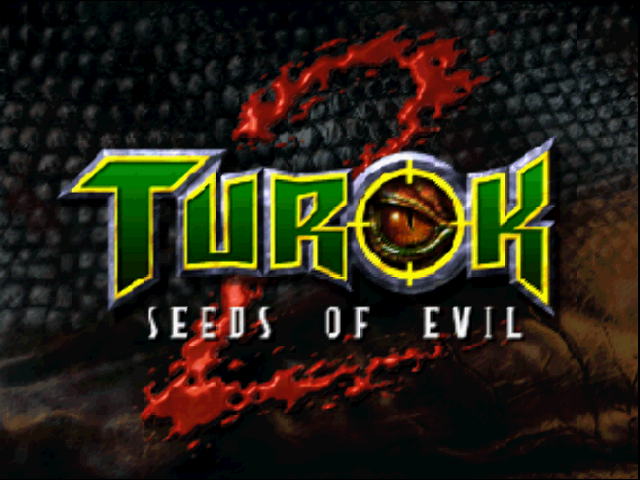
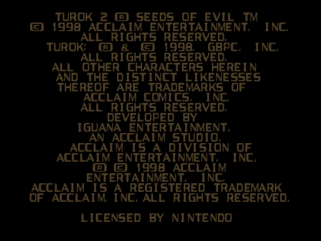
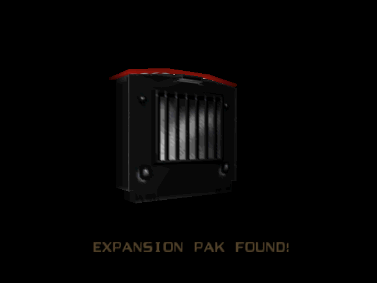
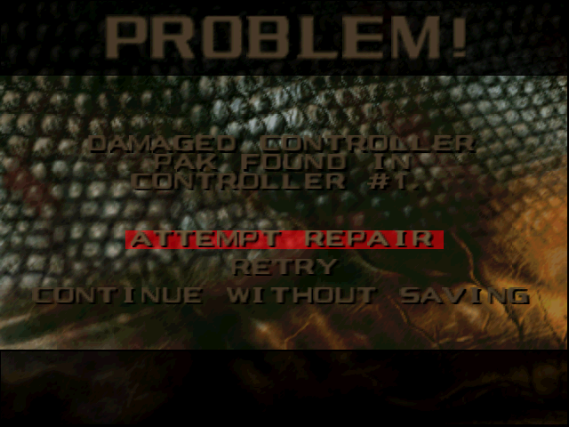
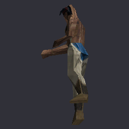
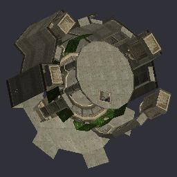
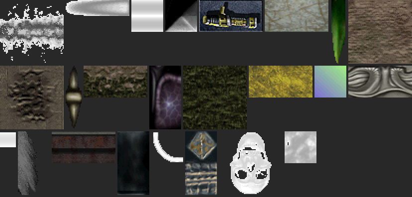
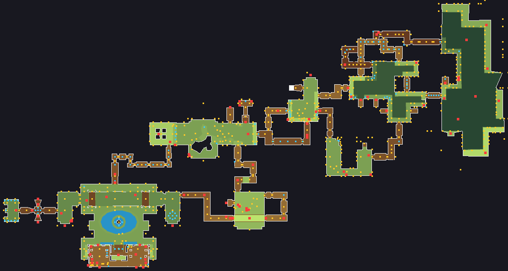

# turok2-decomp

[-blue)](#roadmap)
[](#roadmap)
[](docs/MATCHING.md)
[](tools/progress.py)
[](tools/progress.py)
[](tools/progress.py)
[](tools/progress.py)
[](docs/VRAM-LAYOUT.md)
[](docs/VRAM-LAYOUT.md)
[](docs/NAMES.md)
[](docs/NAMES.md#round-g2-the-globals)
[](docs/MICROCODE.md)
[](https://claude.com/claude-code)
[](LICENSE)

Work-in-progress **matching decompilation** of **Turok 2: Seeds of Evil** (Nintendo 64, US 1.0): C source that compiles back to the exact original ROM.

> **Status: all the C is matched.** The ROM rebuilds byte-exact from C (`make verify` passes the SHA1): 2,531 engine functions and 1,311 functions of the paged VM modules, built with SN64 GCC 2.8.1 (`cc1 -O2 -mno-fix4300`) + `asn64`. 52 files are marked FAKEMATCH, each documented (round 21's audit found 58 unmarked fakes and de-faked 25 functions, round 22 de-faked 5 more, rewrote 9 and marked 6 the audit had missed; [docs/MATCHING.md](docs/MATCHING.md)), and 99.83% is readable C with named fields. The badges count C-origin code; the 9 KB of hand-written asm (libultra's `.s` files, SN64's boot and TLB code, the RNC unpacker, the exception stubs) is tracked apart ([docs/ASM_ORIGIN.md](docs/ASM_ORIGIN.md)).
>
> **Native PC port (Phase 7, closed):** the same C runs as a 64-bit program on libultraship, on Linux and macOS. A new game plays through to the good ending, frame for frame the same on both hosts, and a self-contained Mac app is ready for its first session in a real window. See [docs/port/STATUS.md](docs/port/STATUS.md) and [docs/port/QUICKSTART.md](docs/port/QUICKSTART.md).

## Screenshots

The native PC port (Phase 7) running the game's own decompiled C on libultraship, captured from the port's framebuffer:

| | |
|:-:|:-:|
|  |  |
| Title screen (mode 7, frame 4214) | Legal screen (mode 1) |
|  |  |
| Expansion Pak screen, a 3D model drawn by Fast3D (mode 3) | Controller Pak menu (mode 0) |

Assets decoded from the ROM by `tools/assets/` (Phase 6), with no game data in the repository:

| | | |
|:-:|:-:|:-:|
|  |  |  |
| Animated model, posed with its skeleton | Static model, textured | Textures (CI4/CI8 with palettes) |

<p align="center"><br>A level's collision regions and actor placements, top down</p>

Screenshots of copyrighted game content, shown to document the project's progress. The images are generated from a ROM the user provides; the ROM itself is never included.

## Why

This decomp is a stepping stone. The end goals are:

1. **A native PC port built from the decompiled source** (macOS on Apple Silicon first, then Windows and Linux), in the same class as the source ports of Ocarina of Time, Majora's Mask, Star Fox 64, Mario Kart 64 and Super Mario 64: the game's own C compiled for the host, with the N64 hardware layer (graphics, audio, input) replaced, assets extracted at runtime from the user's ROM, and modern enhancements (widescreen, high frame rate, mouse-look, mods).
2. Reusing the work to port **Armorines: Project S.W.A.R.M.**, which Acclaim Studios London built on the Turok 2 engine.
3. Stretch goal: Android.

If you only want to play Turok 2, an emulator is 100× less work and totally fine. This project exists for native ports, modding (HD textures, real widescreen, 60 FPS), and preservation.

## Engine

**Turok engine** (Iguana Entertainment / Acclaim Studios Austin) — descended from Turok 1's, and reused by Turok 3, Turok: Rage Wars, and by Acclaim Studios London for Armorines.

## Required input

- `baserom.us.z64` — ROM dump from your own cartridge. **Not committed**, never will be.
  - Expected SHA1: `fb0400f21e3f043939ab56500c7b12a3231006f1`
  - Internal name: `Turok 2: Seeds of Ev`, cartridge ID `NT2E`, 32 MB.

## Setup (Apple Silicon macOS)

On an x86_64 Linux host the same steps run without containers: install
`binutils-mips-linux-gnu`, `cpp`, `dos2unix` and the i386 C runtime
(`libc6:i386`), and `cc1` runs natively, far faster than emulated.

```bash
# 0. The libultra sources the build compiles: decompals/ultralib, a pinned
#    submodule (clone with --recursive, or:)
git submodule update --init

# 1. Clone reference projects (gitignored, not part of this repo)
mkdir -p references && cd references
git clone --recursive https://github.com/Drahsid/turok3.git
git clone https://github.com/Drahsid/LibTEngine.git
cd ..

# 2. Pull SN64 toolchain + LibTEngine headers into the working tree
./scripts/setup-from-references.sh

# 3. Disasm the ROM. splat is pure Python and runs natively on arm64 in ~7s —
#    no container needed for this step.
python3 -m venv .venv && ./.venv/bin/pip install -r tools/requirements.txt
make setup PYTHON=./.venv/bin/python

# 4. The recovered function entry points (versions/symbols_from_scan.us.txt,
#    undefined_funcs_extra.us.txt) are committed; re-derive them only when
#    changing the seeding: ./.venv/bin/python tools/function_seed.py --write

# 5. Build the linux/amd64 container. Only the assemble/link path needs it:
#    cc1 is an i386 ELF and asn64.exe is Win32.
docker build --platform=linux/amd64 -t turok2-build .

# 6. Assemble and link
docker run --platform=linux/amd64 --rm -v "$PWD":/work turok2-build \
    bash -c "make rom C_FILES="

```

The game C is in one directory per recovered object file: `src/us/code/<module>/` (`.code`),
`src/us/vm1/<module>/` and `src/us/vm2/<module>/` (the paged VM module and its stale copy), and
`src/port_libultra/` (libultra C only the port compiles); `python3 tools/srcfiles.py func_0027ECF0`
prints a file's path ([docs/MODULES.md](docs/MODULES.md)).

Progress is measured with `./.venv/bin/python tools/metrics.py`, which reports decode
and symbol coverage rather than matched-function counts.

## Standing on the shoulders of

- **[Drahsid/turok3](https://github.com/Drahsid/turok3)** — in-progress decomp of Turok 3 (same engine). Foundation for the official Turok 3 Remastered.
- **[AbuN64/ragewars-decomp](https://github.com/AbuN64/ragewars-decomp)** — matching decomp of Turok: Rage Wars, the same engine a year later. Hundreds of Turok 2 functions compile from its C unchanged; those files carry its C, cut down to the one function and with Turok 2's symbol names (`tools/xmatch_ref.py`, `tools/import_ref.py`), and say so in their header. Hundreds more are *near* copies: the same code over structs laid out differently (Turok 2's level actor is 0x288 bytes, Rage Wars' 0x2E8) or with other constants; those were retyped by hand to Turok 2's layouts.
- **[thejunkman9000/Turok-Rage-Wars-Decomp](https://github.com/thejunkman9000/Turok-Rage-Wars-Decomp)** — another Rage Wars decomp, with a native PC port; Turok 2 functions taken from its C the same way say so in their header.
- **[Drahsid/LibTEngine](https://github.com/Drahsid/LibTEngine)** — reverse-engineered structs and function signatures for the Turok 2 / Turok 3 engine. Major head start.
- **[libultraship](https://github.com/Kenix3/libultraship)** (Harbour Masters) — the platform layer (Fast3D renderer, audio, input, resource archives) behind Ship of Harkinian, 2 Ship 2 Harkinian, Starship, SpaghettiKart and Ghostship; the leading candidate for this port's platform layer, and the model for it either way.
- **[Mr-Wiseguy/N64Recomp](https://github.com/Mr-Wiseguy/N64Recomp)** + **[RT64](https://github.com/rt64/rt64)** — static recompilation; tried early here (see the shelved track below).
- **[ethteck/splat](https://github.com/ethteck/splat)** — disassembler / segment splitter.
- **[matt-kempster/m2c](https://github.com/matt-kempster/m2c)** — MIPS → C decompiler for matching.
- **[simonlindholm/decomp-permuter](https://github.com/simonlindholm/decomp-permuter)** — randomized C rewrites for near-matches (`tools/permuter/`).
- **[Ghidra](https://github.com/NationalSecurityAgency/ghidra)** — analysis and readable decompilation for understanding systems (HUD, camera, player) before they are matched. Every name, prototype, struct and comment lives in the repo (`versions/names.us.txt`, `tools/ghidra/annotations.json`, `include/structs/`) and is re-applied to the Ghidra project by `tools/ghidra/`, so the project is a disposable working copy.

## Roadmap

The goal is a **native PC port built from the decompiled source**. The order is
deliberate: a byte-exact decomp first, then code that is readable end to end,
then assets and a 64-bit build, then the port. Each step is what makes the next
one possible.

### Phase 1 — Bootstrap (complete)
- [x] Confirm ROM dump (SHA1 verified)
- [x] Toolchain working (SN64 binaries; splat runs natively on arm64)
- [x] First splat pass produces asm + linker script
- [x] Entry point confirmed at `0x80000400` (`romMain`)

### Phase 2 — Microcode triage (complete)
- [x] Dump RSP `ucode_text` / `ucode_data` and diff against stock
- [x] **Verdict: stock `F3DEX.NoN fifo 2.05` + `aspMain`.** No custom RSP code, so
      a stock F3DEX renderer (such as Fast3D) can draw the game's display lists

### Phase 3 — Segmentation and symbols (complete)
- [x] Recover the memory map: code in useg (TLB-mapped), data and libultra in KSEG0
- [x] 95.2% of the ROM decoded, 13,275 functions delimited
- [x] ELF links and the ROM rebuilds byte-exact from asm: `make verify` passes the SHA1
- [x] Locate the `virtual` segment's real start: ROM 0x14A000 = vaddr 0x400000, from `VM_Initialize`'s page region; `gVirtualRomStart`, module 1 is `gVirtualModule1Size` = 0x3CAE0 bytes ([SEGMENTS.md](docs/SEGMENTS.md#the-virtual-segments-real-start-round-21))

### Phase 4 — Matching decomp (complete)
- [x] Compiler identified: SN64 GCC 2.8.1 `cc1 -O2`
- [x] Per-function check against the ROM (`tools/match_func.py`) and a progress metric (`tools/progress.py`)
- [x] Bulk matching from m2c drafts, hand matching, decomp-permuter batches
- [x] Functions own their `.rdata` slice from C: switch tables and float pools
- [x] **All C-origin code matched**: 2,531 engine functions + 1,311 VM-module functions, `make verify` passes
- [x] 99.83% readable C (named struct fields, no m2c offset macros)

### Phase 5 — Readable code (complete except struct hoisting, the last BSS views and VM data names, and module merges)
What a source port needs: code a person can read and change without breaking it. Final state after round 23 ([docs/port/STATUS.md](docs/port/STATUS.md)).
- [x] Shared struct headers in `include/structs/` (offsets checked with `tools/check_structs.py`)
- [x] The host reads every engine struct by its members where the N64 offsets differ: round 23 fixed `ImpactEvent_ApplyBlast`, `Rumble_SetLink`, `GameObject_GetFloorKind`, `PlayerSetupMenu_NameLabel`, `OptionsMenu_ResolutionText`; raw/BAD is the 10 known look-alikes; the default run's det md5 is `cd2d68ce` ([STABILITY.md](docs/port/STABILITY.md) 14)
- [ ] Hoist the remaining repeated local structs: 142 of 698 local names in 2+ files, host-view twins 62. More is possible (header work): one-layout families such as `T2HostTriple` (17 files); the rest are per-function scratch structs, VM-copy pairs and views FAKEMATCH files need ([docs/STRUCTS_TODO.md](docs/STRUCTS_TODO.md))
- [x] Name the functions: 4,025 game C functions, 3,937 named. Documented: the 88 `func_` left are stubs, getters and tests of unknown structs with no evidence for a name, and five whose real name changes the code (`cosf`, `sinf`, `sqrtf`, `memcpy` are GCC builtins; `main`) ([docs/NAMES.md](docs/NAMES.md#left-as-func_-round-21))
- [ ] Name the globals: 1,704 data names; 93 distinct `D_` tokens left in src/include (142 before round 24). Round 24 (m2) turned 51 BSS `D_` into members of their owner, field symbols or names of their own (13 CCollisionInfo slots). Documented as staying: 52 pool words (their pools), 11 labels in code, linker/stack bounds and absolute offsets, comment mentions. Still possible: ~10 BSS anchors/views (`D_800D7BE0` gCache, `D_800F55F4`, `D_800E6790`...), 10 VM data names ([docs/NAMES.md](docs/NAMES.md#round-24-part-m2-the-bss-d_-as-members-or-names))
- [x] Float and string pools written as C literals: 471 of 1,076 `D_` gone, each file owning its `.rodata` slice ([docs/MATCHING.md](docs/MATCHING.md))
- [x] One declaration with the real type for every global: 48 headers in `include/globals/`; local `extern`s 5,269 -> 269 lines. Documented: 239 are commented local views the matching code needs, 27 names have no header (field symbols, one-file views, non-game symbols), 0 redeclare a header global silently ([docs/GLOBALS.md](docs/GLOBALS.md))
- [x] FAKEMATCH: 52 files marked, 30 de-faked in rounds 21-22. Documented: each says why the fake works and what it misses by without it; what is left needs the permuter or changes the ROM ([docs/MATCHING.md](docs/MATCHING.md#the-fakematch-second-pass-round-22))
- [x] One body for the N64 and the host where the host's compiles to the same N64 code: 496 `TARGET_PORT` alternatives dropped (`tools/unify_host_bodies.py`)
- [x] Recover the original source-file boundaries: 320 modules ([docs/MODULES.md](docs/MODULES.md)); every game C file is in its module's directory (`src/us/{code,vm1,vm2}/<module>/`, `tools/srcfiles.py`), the port's libultra copies in `src/port_libultra/`
- [ ] One C file per module: 14 small modules merged byte-exact (`tools/merge_module.py`); 101 module directories still hold one function per file. Possible, but header work: one declaration per name across a module, and its `.rodata` in `.text` order
- [x] libultra from [decompals/ultralib](https://github.com/decompals/ultralib) 2.0I `libgultra_rom`, a pinned submodule: 120 of 173 modules built from its sources; the other 53 stay the game's C, each with its reason ([docs/LIBULTRA.md](docs/LIBULTRA.md))

### Phase 6 — Assets
- [x] Map every asset in the ROM: models, textures, levels, animations, sounds, music, text. 100% of the asset region (0x1E0000-0x1FF7AEC, 31.5 MB) classified, 99.7% exported to files: 2705 models, 1839 textures + 114 graphic sets, 490 skeletons / 1857 animations, 165 levels, 197 cinemas, 2 sound banks (866 waves), 1319 effects, 19 sequences, 140 streams. See [docs/assets/README.md](docs/assets/README.md)
- [x] Extractor that builds a resource archive from the user's ROM (the port ships no game data): `tools/assets/mkarchive.py baserom.us.z64 -o turok2.o2r` checks the ROM (z64/v64/n64, SHA1) and writes a libultraship `.o2r`: 26,124 load units as standard Blob resources keyed by ROM address (`t2/u/XXXXXXXX`), RNC pre-decompressed, 33.9 MB, deterministic, ~8 s; `tools/assets/archive_check.py` verifies every entry against the ROM ([docs/assets/ARCHIVE.md](docs/assets/ARCHIVE.md)). Byte order for little-endian hosts: `tools/assets/swap_spec.json`, 99.5% of unit bytes typed ([docs/assets/BYTEORDER.md](docs/assets/BYTEORDER.md)). Torch module for distribution: next
- [x] The port loads every asset through the archive instead of fixed ROM offsets (`port/assets/t2asset.c`, [docs/assets/PORT.md](docs/assets/PORT.md)); the matching build keeps its ROM offsets

### Phase 7 — Native build (closed)
The round-by-round history is in [docs/port/STATUS.md](docs/port/STATUS.md).
- [x] Builds with a modern compiler alongside the matching build: `port/` (CMake + Ninja, clang), 64-bit, without changing the matching build (`tools/asm_diff.py`: 0 differences) ([docs/port/BUILD.md](docs/port/BUILD.md))
- [x] Game data from the user's ROM: typed host-layout C generated by `tools/port/gendata.py` and the `.o2r` archive; a fresh clone builds with only the ROM ([docs/port/DATA.md](docs/port/DATA.md))
- [x] Platform layer on libultraship 2.0: Fast3D rendering, audio, controllers and an N64-compatible Controller Pak ([docs/port/LIBULTRASHIP.md](docs/port/LIBULTRASHIP.md))
- [x] The whole game playable: a new game through levels 1-6, every boss, to the good ending, with the N64's random stream and the same result on Linux and macOS ([docs/port/PLAYTHROUGH.md](docs/port/PLAYTHROUGH.md))
- [x] Checked against the N64: attract demos 1 and 3 identical to the N64's RAM; render and audio compared scene by scene ([docs/port/FIDELITY.md](docs/port/FIDELITY.md))
- [x] A self-contained `Turok2.app` for macOS ([docs/port/QUICKSTART.md](docs/port/QUICKSTART.md))
- [ ] 64-bit clean everywhere: the known pointer-width classes are fixed and guarded by checkers (`n64viewcheck.py`, `outptr.py`, `abicheck.py`); some sites remain ([docs/port/64BIT.md](docs/port/64BIT.md))
- [ ] First session in a real window with a person and a gamepad ([docs/port/FIRSTRUN.md](docs/port/FIRSTRUN.md))

### Phase 8 — Enhancements
- [ ] Widescreen, high frame rate, mouse-look and keyboard
- [ ] Mod support (texture packs, settings menu)
- [ ] Windows and Linux builds; Armorines on the same base

### Shelved: recompilation track
N64Recomp was run early against the ELF and produced full C output (31.4 MB,
5,525 functions, with the jump-table fix in
[mgrz18/N64Recomp@mac-port](https://github.com/mgrz18/N64Recomp/tree/mac-port)).
It is not the goal: a recomp keeps the game an N64 program in translation, while
a source port makes it a PC program that can be changed freely. It also stalls on
the TLB (below).

## The TLB question

Turok 2 runs its code TLB-mapped: the boot stub programs a 2 MB page mapping vaddr
`0x00200000` to paddr `0x0`, and the `virtual` modules are paged in on demand by
`VMASM.S` / `VMEMORY.C`.

N64Recomp does not support TLB. A source port does not need it: with the whole
game in C, the paged modules are linked as ordinary code and the pager goes away.
That is how the TLB-using N64 games that run natively got there (GoldenEye
rebuilds a TLB-free ROM from its decomp, Perfect Dark ships as a decomp-based
port), and it is the route this project takes.

## Built with

Developed with **[Claude Code](https://claude.com/claude-code)** (Opus 5) under human
direction — reverse engineering, splat configuration, tooling, and most of the prose here.

## Legal

The ROM is not distributed here. Provide your own dump from a cartridge you own. Original game code and assets are property of the Turok IP rights holders.

The reverse-engineered work in this repository (symbol names, struct definitions, splat configs, Makefiles, scripts) is released under [**CC0-1.0**](LICENSE) — public domain. See `LICENSE` for the full text.
