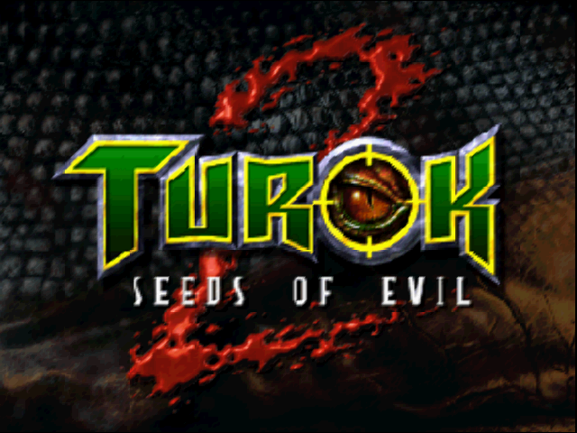
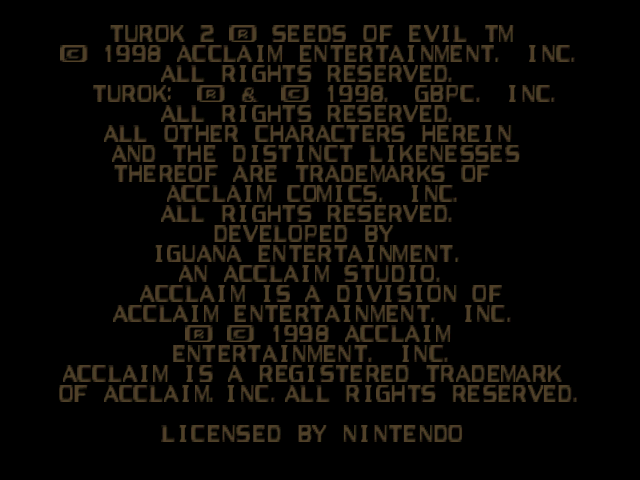
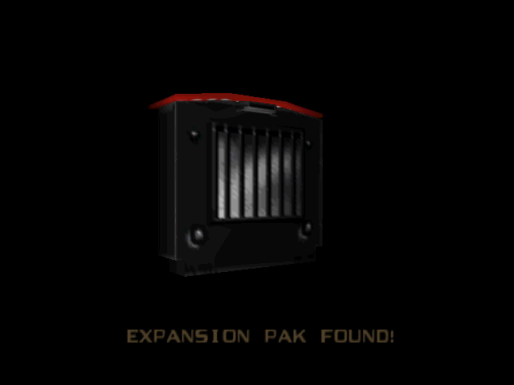
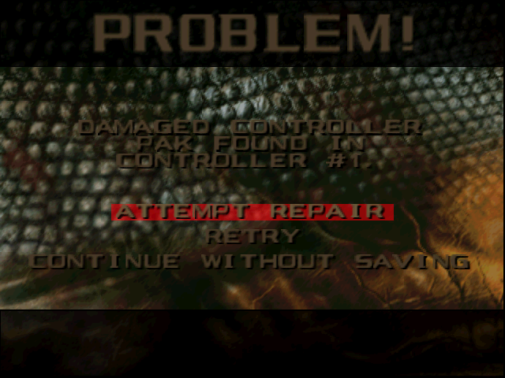
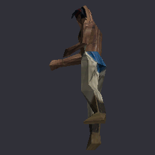
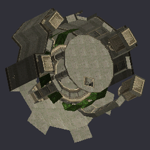
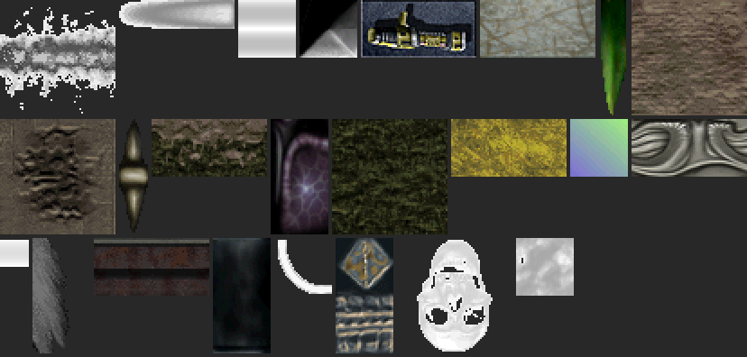
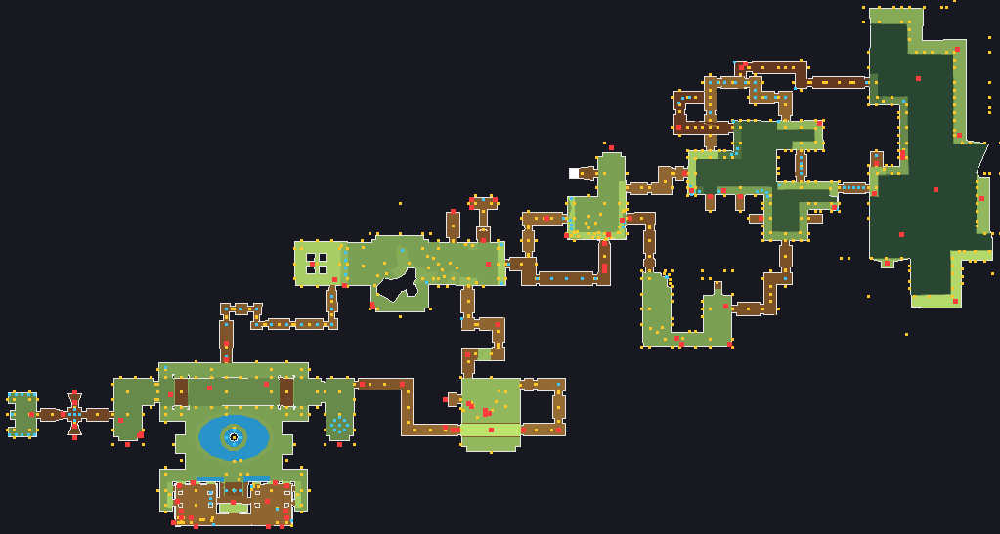

# turok2-decomp

[-blue)](#roadmap)
[](#roadmap)
[](docs/MATCHING.md)
[](tools/progress.py)
[](tools/progress.py)
[](tools/progress.py)
[](tools/progress.py)
[](docs/VRAM-LAYOUT.md)
[](docs/VRAM-LAYOUT.md)
[](docs/NAMES.md)
[](docs/NAMES.md#round-g2-the-globals)
[](docs/MICROCODE.md)
[](https://claude.com/claude-code)
[](LICENSE)

Work-in-progress **matching decompilation** of **Turok 2: Seeds of Evil** (Nintendo 64, US 1.0): C source that compiles back to the exact original ROM.

> **Status: all the C is matched.** The ROM rebuilds byte-exact (`make verify` passes the SHA1), and the compiler is identified: engine code matches through SN64 GCC 2.8.1 `cc1 -O2 -mno-fix4300` + `asn64`. Every function that was C in the original is now matched C linked into the ROM: 2,531 engine functions and 1,311 functions of the paged VM modules, which build with the same toolchain (100% of the C-origin code; 99.07% of all code bytes, the rest being hand-written asm, below). 16 of them are FAKEMATCH, documented in their files and in [docs/MATCHING.md](docs/MATCHING.md). The VM modules' second copy (81 KB, the first copy's bytes again, which cannot be C of its own) is left out of both sides of that figure. 99.83% of the C-origin code is also *readable* C, with named fields rather than m2c's offset macros ([docs/MATCHING.md](docs/MATCHING.md)); `tools/progress.py` tracks the share. The matched badges are over C-origin code: the 9 KB that is hand-written asm by origin (libultra's `.s` files, SN64's boot and TLB code, the RNC unpacker, the exception stubs) and three dead fragments can never be C, so `tools/progress.py` lists them in their own `asm (by origin)` row ([docs/ASM_ORIGIN.md](docs/ASM_ORIGIN.md)) and the badges reach 100% when all the C is matched; its `all code` row (`--badge --raw`) keeps the share of every byte.
>
> **Next: a native PC port built from this source**, in the line of Ship of Harkinian, 2 Ship 2 Harkinian, Starship, SpaghettiKart and Ghostship. Before that, the code has to be readable end to end: named functions, globals and structs. See the [roadmap](#roadmap).

## Screenshots

The native PC port (Phase 7) running the game's own decompiled C on libultraship, 64-bit, headless on Linux. Frames are captured from the port's framebuffer. It boots on its own through the Controller Pak check, the legal screen and the Expansion Pak screen to the title screen. Both intro cinemas render (the Acclaim logo is an animated actor), the new-game cinemas draw their animated characters, the three attract demos play, and a new game started from the menu reaches the first level (the Port of Adia, level 51): the level draws with the HUD and the weapon in Turok's hand, and scripted input walks, turns and swims the player through the harbour, picks weapons from the wheel and fires them (13 weapons, with their projectiles, muzzle flashes, shell casings and impacts). A real level exit warps the player to level 52 and back. Combat works both ways: enemies hurt the player (the HUD health falls, death, respawn with a life less, GAME OVER) and the player kills them (blood, death animations, the corpses melt). The boss fights run (the Mother attacks and loses her first part), a save goes to an N64-compatible Controller Pak and loads back from the title, pickups are collected, the pause and options menus work and doors open. Linux and macOS, headless, with audio ([docs/port/STATUS.md](docs/port/STATUS.md)).

| | |
|:-:|:-:|
|  |  |
| Title screen (mode 7, frame 4214) | Legal screen (mode 1) |
|  |  |
| Expansion Pak screen, a 3D model drawn by Fast3D (mode 3) | Controller Pak menu (mode 0) |

Assets decoded from the ROM by `tools/assets/` (Phase 6), with no game data in the repository:

| | | |
|:-:|:-:|:-:|
|  |  |  |
| Animated model, posed with its skeleton | Static model, textured | Textures (CI4/CI8 with palettes) |

<p align="center"><br>A level's collision regions and actor placements, top down</p>

Screenshots of copyrighted game content, shown to document the project's progress. The images are generated from a ROM the user provides; the ROM itself is never included.

## Why

This decomp is a stepping stone. The end goals are:

1. **A native PC port built from the decompiled source** (macOS on Apple Silicon first, then Windows and Linux), in the same class as the source ports of Ocarina of Time, Majora's Mask, Star Fox 64, Mario Kart 64 and Super Mario 64: the game's own C compiled for the host, with the N64 hardware layer (graphics, audio, input) replaced, assets extracted at runtime from the user's ROM, and modern enhancements (widescreen, high frame rate, mouse-look, mods).
2. Reusing the work to port **Armorines: Project S.W.A.R.M.**, which Acclaim Studios London built on the Turok 2 engine.
3. Stretch goal: Android.

If you only want to play Turok 2, an emulator is 100× less work and totally fine. This project exists for native ports, modding (HD textures, real widescreen, 60 FPS), and preservation.

## Engine

**Turok engine** (Iguana Entertainment / Acclaim Studios Austin) — descended from Turok 1's, and reused by Turok 3, Turok: Rage Wars, and by Acclaim Studios London for Armorines.

## Required input

- `baserom.us.z64` — ROM dump from your own cartridge. **Not committed**, never will be.
  - Expected SHA1: `fb0400f21e3f043939ab56500c7b12a3231006f1`
  - Internal name: `Turok 2: Seeds of Ev`, cartridge ID `NT2E`, 32 MB.

## Setup (Apple Silicon macOS)

On an x86_64 Linux host the same steps run without containers: install
`binutils-mips-linux-gnu`, `cpp`, `dos2unix` and the i386 C runtime
(`libc6:i386`), and `cc1` runs natively, far faster than emulated.

```bash
# 1. Clone reference projects (gitignored, not part of this repo)
mkdir -p references && cd references
git clone --recursive https://github.com/Drahsid/turok3.git
git clone https://github.com/Drahsid/LibTEngine.git
cd ..

# 2. Pull SN64 toolchain + LibTEngine headers into the working tree
./scripts/setup-from-references.sh

# 3. Disasm the ROM. splat is pure Python and runs natively on arm64 in ~7s —
#    no container needed for this step.
python3 -m venv .venv && ./.venv/bin/pip install -r tools/requirements.txt
make setup PYTHON=./.venv/bin/python

# 4. The recovered function entry points (versions/symbols_from_scan.us.txt,
#    undefined_funcs_extra.us.txt) are committed; re-derive them only when
#    changing the seeding: ./.venv/bin/python tools/function_seed.py --write

# 5. Build the linux/amd64 container. Only the assemble/link path needs it:
#    cc1 is an i386 ELF and asn64.exe is Win32.
docker build --platform=linux/amd64 -t turok2-build .

# 6. Assemble and link
docker run --platform=linux/amd64 --rm -v "$PWD":/work turok2-build \
    bash -c "make rom C_FILES="

```

Progress is measured with `./.venv/bin/python tools/metrics.py`, which reports decode
and symbol coverage rather than matched-function counts.

## Standing on the shoulders of

- **[Drahsid/turok3](https://github.com/Drahsid/turok3)** — in-progress decomp of Turok 3 (same engine). Foundation for the official Turok 3 Remastered.
- **[AbuN64/ragewars-decomp](https://github.com/AbuN64/ragewars-decomp)** — matching decomp of Turok: Rage Wars, the same engine a year later. Hundreds of Turok 2 functions compile from its C unchanged; those files carry its C, cut down to the one function and with Turok 2's symbol names (`tools/xmatch_ref.py`, `tools/import_ref.py`), and say so in their header. Hundreds more are *near* copies: the same code over structs laid out differently (Turok 2's level actor is 0x288 bytes, Rage Wars' 0x2E8) or with other constants; those were retyped by hand to Turok 2's layouts.
- **[thejunkman9000/Turok-Rage-Wars-Decomp](https://github.com/thejunkman9000/Turok-Rage-Wars-Decomp)** — another Rage Wars decomp, with a native PC port; Turok 2 functions taken from its C the same way say so in their header.
- **[Drahsid/LibTEngine](https://github.com/Drahsid/LibTEngine)** — reverse-engineered structs and function signatures for the Turok 2 / Turok 3 engine. Major head start.
- **[libultraship](https://github.com/Kenix3/libultraship)** (Harbour Masters) — the platform layer (Fast3D renderer, audio, input, resource archives) behind Ship of Harkinian, 2 Ship 2 Harkinian, Starship, SpaghettiKart and Ghostship; the leading candidate for this port's platform layer, and the model for it either way.
- **[Mr-Wiseguy/N64Recomp](https://github.com/Mr-Wiseguy/N64Recomp)** + **[RT64](https://github.com/rt64/rt64)** — static recompilation; tried early here (see the shelved track below).
- **[ethteck/splat](https://github.com/ethteck/splat)** — disassembler / segment splitter.
- **[matt-kempster/m2c](https://github.com/matt-kempster/m2c)** — MIPS → C decompiler for matching.
- **[simonlindholm/decomp-permuter](https://github.com/simonlindholm/decomp-permuter)** — randomized C rewrites for near-matches (`tools/permuter/`).
- **[Ghidra](https://github.com/NationalSecurityAgency/ghidra)** — analysis and readable decompilation for understanding systems (HUD, camera, player) before they are matched. Every name, prototype, struct and comment lives in the repo (`versions/names.us.txt`, `tools/ghidra/annotations.json`, `include/structs/`) and is re-applied to the Ghidra project by `tools/ghidra/`, so the project is a disposable working copy.

## Roadmap

The goal is a **native PC port built from the decompiled source**. The order is
deliberate: a byte-exact decomp first, then code that is readable end to end,
then assets and a 64-bit build, then the port. Each step is what makes the next
one possible.

### Phase 1 — Bootstrap (complete)
- [x] Confirm ROM dump (SHA1 verified)
- [x] Toolchain working (SN64 binaries; splat runs natively on arm64)
- [x] First splat pass produces asm + linker script
- [x] Entry point confirmed at `0x80000400` (`romMain`)

### Phase 2 — Microcode triage (complete)
- [x] Dump RSP `ucode_text` / `ucode_data` and diff against stock
- [x] **Verdict: stock `F3DEX.NoN fifo 2.05` + `aspMain`.** No custom RSP code, so
      a stock F3DEX renderer (such as Fast3D) can draw the game's display lists

### Phase 3 — Segmentation and symbols (complete)
- [x] Recover the memory map: code in useg (TLB-mapped), data and libultra in KSEG0
- [x] 95.2% of the ROM decoded, 13,275 functions delimited
- [x] ELF links and the ROM rebuilds byte-exact from asm: `make verify` passes the SHA1
- [ ] Locate the `virtual` segment's real start ([#23](https://github.com/mgrz18/turok2-decomp/issues/23))

### Phase 4 — Matching decomp (complete)
- [x] Compiler identified: SN64 GCC 2.8.1 `cc1 -O2`
- [x] Per-function check against the ROM (`tools/match_func.py`) and a progress metric (`tools/progress.py`)
- [x] Bulk matching from m2c drafts, hand matching, decomp-permuter batches
- [x] Functions own their `.rdata` slice from C: switch tables and float pools
- [x] **All C-origin code matched**: 2,531 engine functions + 1,311 VM-module functions, `make verify` passes
- [x] 99.83% readable C (named struct fields, no m2c offset macros)

### Phase 5 — Readable code (in progress)
What a source port needs: code a person can read and change without breaking it.
- [x] Shared struct headers in `include/structs/` (offsets checked with `tools/check_structs.py`)
- [ ] Hoist the remaining repeated local structs: 229 names in 2+ files (291 before round L; mostly per-function scratch views and module-1/module-2 pairs; [docs/STRUCTS_TODO.md](docs/STRUCTS_TODO.md))
- [ ] Name the functions: 3,823 of the 4,146 C functions named (92%; 3,932 names with the asm ones), from Turok 3's and Rage Wars' decomps, libultra, the ROM's strings and SN64 debug records (`versions/names.us.txt`, `versions/names/`, `tools/apply_names.py`; [docs/NAMES.md](docs/NAMES.md))
- [ ] Name the globals: 1,204 data names (1,179 of the 2,266 `D_` symbols the C used, 105 of them module-2 `_2`), from Turok 3's and Rage Wars' names, libultra and the code that uses them (`versions/names/data_*.us.txt`); 605 `D_` are left in the C, 514 of them table data and BSS (menu and pak text tables), 91 pool words kept for a reason ([docs/NAMES.md](docs/NAMES.md#round-g2-the-globals))
- [x] Float and string pools written as C literals: 471 of the 1,076 `D_` symbols the C read are gone, each converted file owning its `.rodata` slice (849 subsegments); checked with `tools/rodata_check.py` / `tools/rodata_match.py` and `make verify` ([docs/MATCHING.md](docs/MATCHING.md))
- [ ] One declaration with the real type for every global: 46 headers in `include/globals/` (1,066 declarations); local `extern`s of named globals 5,269 -> 911 -> 330 (223 of them commented local types, 119 lines still without a header: `gEngineApp_m_SwooshSystem`, `gScheduler`, field symbols read through views, the audio DMA state); checked with `tools/asm_diff.py` ([docs/GLOBALS.md](docs/GLOBALS.md))
- [ ] De-fake the 16 FAKEMATCH functions: all 16 documented (each file says why the fake works and which natural forms were tried; none de-faked in round L) ([docs/MATCHING.md](docs/MATCHING.md))
- [ ] Recover the original source-file boundaries and group functions into real modules
- [ ] libultra from [decompals/ultralib](https://github.com/decompals/ultralib) (`libgultra`)

### Phase 6 — Assets
- [x] Map every asset in the ROM: models, textures, levels, animations, sounds, music, text. 100% of the asset region (0x1E0000-0x1FF7AEC, 31.5 MB) classified, 99.7% exported to files: 2705 models, 1839 textures + 114 graphic sets, 490 skeletons / 1857 animations, 165 levels, 197 cinemas, 2 sound banks (866 waves), 1319 effects, 19 sequences, 140 streams. See [docs/assets/README.md](docs/assets/README.md)
- [x] Extractor that builds a resource archive from the user's ROM (the port ships no game data): `tools/assets/mkarchive.py baserom.us.z64 -o turok2.o2r` checks the ROM (z64/v64/n64, SHA1) and writes a libultraship `.o2r`: 26,124 load units as standard Blob resources keyed by ROM address (`t2/u/XXXXXXXX`), RNC pre-decompressed, 33.9 MB, deterministic, ~8 s; `tools/assets/archive_check.py` verifies every entry against the ROM ([docs/assets/ARCHIVE.md](docs/assets/ARCHIVE.md)). Byte order for little-endian hosts: `tools/assets/swap_spec.json`, 99.5% of unit bytes typed ([docs/assets/BYTEORDER.md](docs/assets/BYTEORDER.md)). Torch module for distribution: next
- [ ] Code loads assets through the archive instead of fixed ROM offsets. Started: the C reader `port/assets/t2asset.c` (`T2Asset_Read(romKey)`, archive and ROM backends, 0 mismatches over all 26,124 units) and the exact loader replacements in [docs/assets/PORT.md](docs/assets/PORT.md) §10; wiring it into the engine is part of the native build
- [ ] Code loads assets through the archive instead of fixed ROM offsets

### Phase 7 — Native build
- [x] Builds with a modern compiler alongside the matching build: `port/` (CMake + Ninja, clang) compiles all 3,917 game C files for 64-bit hosts with 0 errors (Linux x86_64; macOS arm64 and Windows x86_64 cross-checked), through shim headers and a source filter, without changing the matching build (`tools/asm_diff.py`: 0 differences) ([docs/port/BUILD.md](docs/port/BUILD.md)). Linked: the engine + module 1 (3,226 files) with the game data generated as typed host-layout C from the ELF (`tools/port/gendata.py`: 1,537 symbols, 1,531 typed, 2,932 pointers relocated; [docs/port/DATA.md](docs/port/DATA.md)) and the port runtime; 1 placeholder left (was 597) ([docs/port/LINK.md](docs/port/LINK.md))
- [ ] 64-bit clean. Audited ([docs/port/64BIT.md](docs/port/64BIT.md), `tools/port/audit64.py`): ~1,900 pointer-through-32-bit-int sites, 1,100 functions with mismatched prototypes (s32 vs pointer), hand-built 8-byte Gfx words; plan: `sptr`/`uptr` typedefs and canonical prototypes, each change proven with `asm_diff`. The second VM module is never called, so the port links the engine + module 1 only and needs no pager. Part 1 done: `sptr`/`uptr`, `include/protos/*.h` generated from the definitions, mismatched declarations 2,073 -> 1,064; host-sized GBI (`include/gbi_t2.h`, 30/30 commands identical to libultraship's; [docs/port/GBI.md](docs/port/GBI.md)); the boot path's heap, cache, frame-buffer pool and synthesizer set-up made host-correct with `sizeof`/`offsetof` (asm_diff 0). Part 2: `tools/port/retype.py` (token-level `sptr`/`uptr` edits and pointer-wide parameters over ~880 files), truncating pointer-width warnings 2,828 -> 1,019
- [ ] Platform layer on libultraship 2.0 ([docs/port/LIBULTRASHIP.md](docs/port/LIBULTRASHIP.md)): the `turok2` executable builds, opens a window (headless too), mounts `turok2.o2r` through LUS's ArchiveManager (all 26,124 units identical to the ROM) and draws with Fast3D. Runtime model ([docs/port/RUNTIME.md](docs/port/RUNTIME.md)): the engine keeps its 8 threads on `port/runtime/t2os` (libultra scheduling rules on host threads, deterministic). Clean-room RNC decompressor (`port/assets/rnc.c`, all 14,426 ROM streams). The archive is format 2.0: the engine's loader, cache and `VM_Alloc` read units through it in host byte order. A virtual PIF serves the controllers and a Controller Pak (an emulator-standard `.mpk` per port; the game's own libultra pfs code runs unchanged) ([docs/port/INPUT.md](docs/port/INPUT.md)). `turok2 --game --draw --pak-blank` runs the whole N64 boot on its own: the pak check, the legal screen, the Expansion Pak screen with its 3D model, the two intro cinemas (the Iguana jungle's static scene and the Acclaim logo, an animated actor: [docs/port/RENDER.md](docs/port/RENDER.md)), the **title screen** at frame 4,214 and the three attract demos (levels 81, 131, 109), looping the boot to frame 26,000 without a crash ([docs/port/STATUS.md](docs/port/STATUS.md)). Scripted input (`--input`) drives a new game from the title into level 51 ([docs/port/GAMEPLAY.md](docs/port/GAMEPLAY.md)). Audio behind `--audio` (`--wav` to a file): sound effects, music (notes identical to the ROM's sequences) and speech (the adec streams) through the boot and the title ([docs/port/AUDIO.md](docs/port/AUDIO.md)). An ABI checker (`tools/port/abicheck.py`, libclang) found the by-value struct and float/int mismatches between declarations and definitions: those classes are at 0 ([docs/port/ABI.md](docs/port/ABI.md)). macOS arm64 runs the boot loop, a new game into level 51 and the audio headless, the same mode sequence at the same frames as Linux, with pixels through `--offscreen-gl` ([docs/port/MACOS.md](docs/port/MACOS.md)). Round 7: the particle system runs on the host (projectiles, impacts, trails; the animation events and hot points on by default), 13 weapons fire with their ammo in the HUD, a level exit warps from level 51 to level 52 and back, the boss levels load (the Mother's cinematic, the arenas draw), the level triggers fire and the enemies wake, face the player and launch their attacks (no hits on the player or kills yet). Round 8: combat both ways (enemies hit, hurt and kill the player: death, the death cinema, respawn, GAME OVER; pistol, shotgun and grenade kills with corpses that sink), the four boss fights run (the Mother hurts the player and loses a part), save and load through an N64-compatible (big-endian) Controller Pak note, pickups (life force, keys, ammo), the pause/options/sound menus, doors open, and fixes that the Mac and Linux share (macOS parity: [docs/port/MACOS.md](docs/port/MACOS.md)). On an Apple M5 a drawn frame costs ~0.55 ms (the N64 budget is 33.3 ms) and the game runs ~60x real time unpaced ([docs/port/PERF.md](docs/port/PERF.md))
- [ ] First window opens with the game; title screen (reached on Linux and macOS, headless: the boot runs to it with the virtual Controller Pak); first level playable (a new game reaches level 51 gameplay on Linux and macOS headless, with audio: the level renders with the HUD and the weapon in Turok's hand, the actors animate, and Turok walks, turns, swims and fires 13 weapons under scripted input; level 52 and the boss levels are reached through warps; enemies hurt and kill the player and die to his weapons, the boss fights run, a save loads back and doors open: [docs/port/STATUS.md](docs/port/STATUS.md))

### Phase 8 — Enhancements
- [ ] Widescreen, high frame rate, mouse-look and keyboard
- [ ] Mod support (texture packs, settings menu)
- [ ] Windows and Linux builds; Armorines on the same base

### Shelved: recompilation track
N64Recomp was run early against the ELF and produced full C output (31.4 MB,
5,525 functions, with the jump-table fix in
[mgrz18/N64Recomp@mac-port](https://github.com/mgrz18/N64Recomp/tree/mac-port)).
It is not the goal: a recomp keeps the game an N64 program in translation, while
a source port makes it a PC program that can be changed freely. It also stalls on
the TLB (below).

## The TLB question

Turok 2 runs its code TLB-mapped: the boot stub programs a 2 MB page mapping vaddr
`0x00200000` to paddr `0x0`, and the `virtual` modules are paged in on demand by
`VMASM.S` / `VMEMORY.C`.

N64Recomp does not support TLB. A source port does not need it: with the whole
game in C, the paged modules are linked as ordinary code and the pager goes away.
That is how the TLB-using N64 games that run natively got there (GoldenEye
rebuilds a TLB-free ROM from its decomp, Perfect Dark ships as a decomp-based
port), and it is the route this project takes.

## Built with

Developed with **[Claude Code](https://claude.com/claude-code)** (Opus 5) under human
direction — reverse engineering, splat configuration, tooling, and most of the prose here.

## Legal

The ROM is not distributed here. Provide your own dump from a cartridge you own. Original game code and assets are property of the Turok IP rights holders.

The reverse-engineered work in this repository (symbol names, struct definitions, splat configs, Makefiles, scripts) is released under [**CC0-1.0**](LICENSE) — public domain. See `LICENSE` for the full text.
